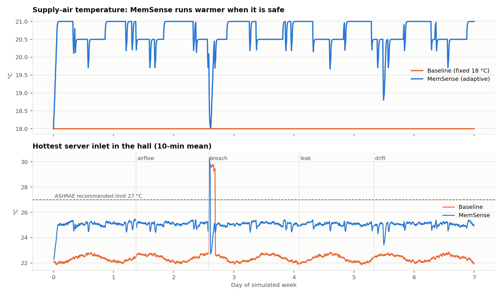

# MemSense — Memory-Aware Thermal Intelligence for Sustainable Data Centres

**Micron-Supported SOLVE Innovation Program (BITS Pilani), 2026 submission**
Focus areas: **#2 IoT & Connected Intelligent Systems**, **#6 AI Applications**, **#1 Semiconductor Technologies**

> Every DDR5 RDIMM (server memory module) already carries **three temperature sensors**, and every NVMe SSD reports its own temperature.
> A full rack of 40 dual-socket servers with 16 RDIMMs each holds about **2,000** of these sensors (the simulated hall below uses 10 servers per rack, about 500). They sit exactly where the heat is, yet each one is only used to drive its own server's fans.
> **MemSense turns Micron memory into a room-wide thermal sensing network.** It adds a rugged low-cost sensor node for what memory cannot sense (humidity, dew point, dust, corrosive gas, airflow pressure, leaks) and edge AI that predicts hotspots.
> Operators can then **run cooling warmer, safely, using less energy and water**.

---

## The problem
- Cooling uses **~30–40%** of a data centre's energy. Indian facilities use **1.5–2.5 L of water per kWh**.
- Operators keep rooms at 20–22 °C even though ASHRAE recommends server inlets up to **27 °C**. They overcool because **they cannot see hotspots early**.
- Each +1 °C of safe warming saves roughly **2–5%** of energy.
- AI racks, liquid cooling, humid monsoons and polluted city air add new risks: condensation, corrosion and leaks.

Sources: [docs/01_research_notes.md](docs/01_research_notes.md)

## The idea (three layers)
| Layer | What | New hardware? |
|---|---|---|
| **1. Memory as a sensor** | DDR5 RDIMM (SPD hub + 2 sensors) and NVMe SSD temperatures, read out-of-band through the server BMC (Redfish) | **None** |
| **2. MemSense Node** | ESP32-S3 node with Micron industrial flash: inlet/outlet temperature and humidity, dew point, aisle pressure, PM2.5, Ag/Cu corrosion coupons, leak rope, pipe-surface temperature. PoE powered, no batteries | ~₹4.5k per rack / ~₹16k per row |
| **3. Edge AI** | 10-minute hotspot forecast, **Airflow Health Index**, sensor self-check, dew-point guard, safe bounded setpoint control (BACnet/Modbus to any cooling vendor) | Gateway per hall |

**Two new metrics:**
- **Memory Thermal Margin**: how far each server's DRAM is from 85 °C, above which DDR5 must refresh twice as often (32 ms refresh window up to 85 °C, 16 ms from 85 to 95 °C, per the Micron 16Gb DDR5 datasheet). Throttling is a separate server-firmware policy.
- **Airflow Health Index (AHI)**: the DIMM-over-inlet temperature rise compared with the rise expected at the current load. It detects clogged or blocked airflow *inside* a server using only the memory's own sensors.

Full design: [docs/02_system_design.md](docs/02_system_design.md)

## Results (simulation)
A 20-rack, ~100 kW hall was simulated for one week. **Baseline and MemSense see identical weather, IT load and faults.**



| Bengaluru, November | Baseline (fixed 18 °C) | MemSense |
|---|---|---|
| Average supply air | 18.0 °C | 20.7 °C |
| Cooling energy | 6,593 kWh | 6,197 kWh (**−6.0%**) |
| Total facility energy | 24,141 kWh | 23,746 kWh (−1.6%) |
| PUE | 1.486 | 1.461 |
| Water | 39,067 L | 38,355 L (−1.8%) |
| Rack-minutes above 27 °C | 301 | 66 |
| Server-minutes with DRAM above 85 °C (2× refresh) | 5 | 0 |
| Condensation on rear-door heat exchangers (humid day)* | 710 min | 0 min |
| False alarms | 0 | 0 |

**Where the Bengaluru saving comes from:** no free-cooling hours occur in either Bengaluru run, so the saving comes from the assumed chiller COP gain per °C of warmer chilled water. Across the 2–5% per °C range in the literature, it is 4.1–9.5% of cooling energy (6.0% at the 3% used here).

\*The baseline's rear-door water runs at a fixed 15 °C with no dew-point control. Commercial CDUs already control water temperature to avoid condensation (see [research notes](docs/01_research_notes.md)), so this number shows the size of the risk, not a gain over best practice. What MemSense adds is a *measured* coil/pipe surface temperature and a room dew point shared across racks, instead of a single setpoint margin.

**Cooler climate (Delhi, January):** cooling energy **−23%**, water **−22%**, total energy −5.3%, PUE 1.398 → 1.324. Warmer setpoints unlock many more free-cooling hours.

**Fault detection (time from fault start to alert):**

| Fault | Baseline | MemSense (what detected it) |
|---|---|---|
| Slowly clogging airflow inside a server (fan alarms silent) | 31 h (BMC critical-only alarm at 85 °C) | 2.8 h (Airflow Health Index) |
| Containment breach (blanking panels removed) | 2 h (manual round) | 2 min (aisle pressure sensor; rack located by temperature gradient) |
| Coolant leak under rear-door heat exchanger | 1 h 50 min (manual round) | < 1 min (leak rope) |
| Node sensor drifting | never | 1.5 h (cross-check with server BMCs) |

These are single simulated events, not statistics. In the slow-clogging event, AHI flagged the server 2.8 h after onset, long before its DRAM approached 85 °C; a BMC critical-only alarm needed 31 h. The leak and breach results come from the leak rope and the aisle pressure sensor, not from the AI; any facility that installs those sensors gets the same benefit.

**Hotspot forecaster** (10 min ahead, held-out data): mean error 0.12 °C vs 0.19 °C for a naive "no change" guess. During temperature transients it is **0.20 °C vs 0.76 °C**.

**Indicative annual impact per 1 MW of IT load** (linear extrapolation of the simulated week):

| | Bengaluru | Delhi (winter week) |
|---|---|---|
| Energy | 213 MWh | 645 MWh |
| Cost (₹8/kWh) | ₹17 lakh | ₹52 lakh |
| CO₂ (0.71 kg/kWh) | 151 t | 458 t |
| Water | 384 kL | 4,151 kL |

The Delhi row extrapolates a *winter* week, so it is an upper bound, not an annual average.

More charts: [airflow fault + AHI](results/figures/03_airflow_fault_ahi.png) · [humid day](results/figures/04_humid_day_dewpoint.png) · [rack heat map](results/figures/05_rack_heatmap_breach.png) · [KPIs](results/figures/02_kpis.png) · [scenarios](results/figures/06_facility_energy_scenarios.png)

## Run it yourself
Requires Python 3.9+.
```bash
python3 -m venv .venv
.venv/bin/pip install -r requirements.txt
.venv/bin/python -m sim.run_all          # ~9 min: trains models, runs all scenarios, writes results/
.venv/bin/streamlit run dashboard.py     # interactive dashboard in the browser
```

## Project structure
```
docs/
  01_research_notes.md       sourced facts (cooling, ASHRAE, DDR5 sensors, Micron)
  02_system_design.md        architecture, node hardware design + BOM, control loop, security
  03_submission_writeup.md   application write-up
sim/
  config.py                  every modelling assumption, in one place
  scenario.py                weather, IT load, fault schedule
  datacenter.py              hall physics ("ground truth") + what sensors report
  facility.py                chiller / economiser / water model
  memsense.py                AHI, sensor self-check, forecaster features, controllers
  runner.py                  runs one week, collects metrics
  train.py                   training week + forecaster / AHI calibration
  compare.py, run_all.py     scenarios, summary, figures
dashboard.py                 Streamlit dashboard
results/                     summary.json, CSVs, figures
```

## Honest limitations
- **Simplified physics, not CFD.** Lumped rack/server thermal model, synthetic weather and load, one week per scenario. It is built to compare control strategies fairly, not to predict a specific building.
- The forecaster and AHI are trained and tested on **simulated** data (separate seeds and fault sets). Real deployment needs calibration on site data.
- **Hardware is a paper design.** Prices are rough estimates; some part numbers and thresholds are marked **[VERIFY]** in the docs.
- Savings depend strongly on climate and on the worst rack in the room. Bengaluru gains are modest; cooler climates and hotspot remediation gain more.
- Annual figures are linear extrapolations of one week.
- **Who owns the servers matters.** In a colocation data centre the operator does not own the tenants' servers and cannot read their BMCs, so Layer 1 (memory as a sensor) needs tenant consent there. MemSense therefore targets enterprise, campus and hyperscale halls first, where one organisation owns both the building and the servers. In colocation, Layers 2 and 3 still work on their own.
- The detection results are single simulated events, and the baseline uses simple practice (fixed setpoints, manual rounds, critical-only BMC alarms, no dew-point control), not a best-in-class facility.

## License
[MIT](LICENSE)
