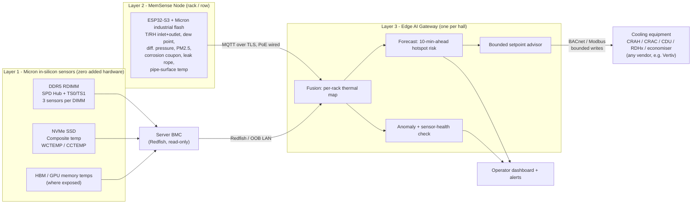
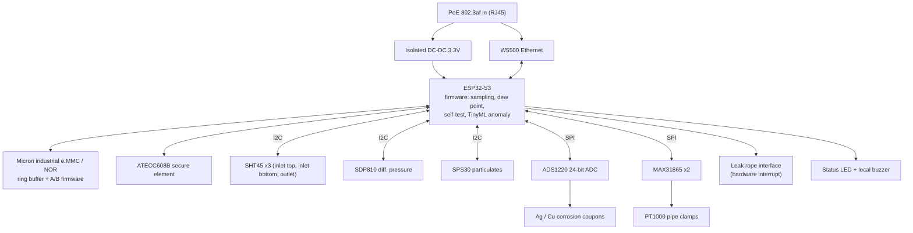
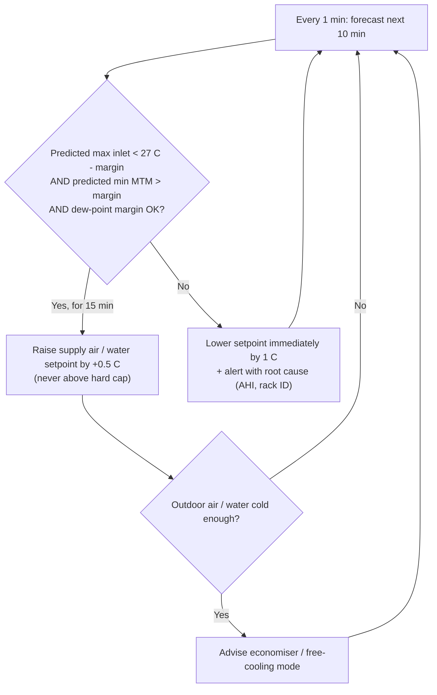

# MemSense — System Design (Hardware on Paper + Software Architecture)

> **One line:** Turn the thousands of temperature sensors already built into Micron DDR5 memory and NVMe SSDs into a room-wide thermal sensing network. Add a rugged low-cost environmental node for the things memory cannot sense. Use edge AI to predict hotspots, so operators can **run cooling warmer, safer and with less water**.

Status: design concept for the SOLVE application. Software is validated in simulation (`sim/`); hardware is a paper design. Part numbers are real catalogue parts, but prices are rough estimates, not quotes. Items marked **[VERIFY]** need confirmation.

---

## 1. The problem in one picture

Operators keep rooms at 20–22 °C even though ASHRAE recommends server inlet temperatures of up to 27 °C. The reason is that **they cannot see hotspots**.
A typical hall has a few wall or CRAH return sensors per row. Hot air recirculating over the top of racks, blocked tiles and failed fans all happen *between* those sensors.
Every +1 °C of unnecessary overcooling wastes about 2–5% of cooling energy (see `01_research_notes.md`).

**MemSense makes it safe to run warmer by seeing more and seeing earlier.**

## 2. Architecture (three layers)

### Why three layers?
| Layer | Sees | Misses |
|---|---|---|
| L1 Memory/SSD sensors | Component temperature *inside* every server, very dense (about 50 per server) | Humidity, dew point, dust, gas, leaks, room air |
| L2 MemSense Node | Air temperature, humidity, pressure, air quality, leaks at rack level | Inside the chassis |
| L3 Edge AI | Combines both, predicts the future, acts | — |

Neither sensor type alone is enough. **Fusing them is the innovation.**

## 3. Layer 1 — Micron memory as a sensor

### What is already there
- **DDR5 RDIMM:** SPD5 Hub with an integrated sensor plus 2 discrete JEDEC temperature sensors (TS0, TS1) = **3 readings per DIMM**, about ±0.5 °C in the hot range. Today the server BMC uses them for fan control, DRAM refresh-rate changes and bandwidth throttling.
- **NVMe SSD:** the SMART/Health log reports composite temperature against the warning (WCTEMP) and critical (CCTEMP) thresholds.
- **Example density:** 2-socket server, 16 RDIMMs, 8 SSDs = **56 sensors per server**. 40 servers per rack = about **2,200 per rack**.

### How MemSense reads them (no agent inside customer OS)
- **Out-of-band via the BMC using DMTF Redfish** (`/redfish/v1/Chassis/{id}/Sensors` or the Thermal resource), with a **read-only** account on the management LAN. This works on bare-metal and cloud tenants alike and needs no OS access.
- Fallbacks: IPMI SDR. In-band Linux `hwmon` (`spd5118` driver) plus `nvme smart-log` for labs and our prototype. **[VERIFY: kernel version that includes spd5118]**
- Polling period 10–30 s; each reading is a few bytes, so the network load is negligible.

### Two new metrics MemSense derives (the "memory insight")
1. **Memory Thermal Margin (MTM)** = 85 °C (DDR5 2× refresh threshold) − hottest DIMM sensor.
   This shows how close each server is to losing memory bandwidth to extra refresh. Source: DDR5 refresh window is 32 ms up to 85 °C and 16 ms from 85 to 95 °C ([Micron 16Gb DDR5 SDRAM datasheet](https://mm.digikey.com/Volume0/opasdata/d220001/medias/docus/7969/16gb-ddr5-sdram-dierevd.pdf)). Throttling is a separate server-firmware policy.
2. **Airflow Health Index (AHI)** = measured (T_DIMM − T_inlet), corrected for fan speed ÷ the rise expected at this server's current load (learned on healthy servers). 1.0 = healthy; MemSense alerts above 1.3 for 10 minutes.
   This is the *thermal resistance* from intake air to memory. If it rises while load is constant, airflow has degraded: a blocked filter, failed fan, missing blanking panel or recirculation.
   **It detects airflow faults inside the chassis with no extra sensor.** This is the core idea.

## 4. Layer 2 — MemSense Node (hardware design on paper)

### 4.1 Two node tiers (cost-efficient coverage)
| Tier | Where | Sensors |
|---|---|---|
| **Node-R (Rack)** | every rack, on the front and rear door | 2× T/RH (inlet top, inlet bottom) + 1× T/RH outlet |
| **Node-X (Row-end, full)** | one per row, or per 8–10 racks | everything in 4.2 |

Node-R is cheap because the memory sensors already give in-rack density. Node-X carries the expensive air-quality, pressure and leak sensors where they are needed.

### 4.2 Bill of materials — Node-X (approximate, India retail, 2026)
| Function | Part | Why this part | ~Cost (INR) |
|---|---|---|---|
| MCU | **Espressif ESP32-S3** module | dual-core, vector instructions for tiny ML at the edge, cheap, well supported | 400 |
| Wired network | **WIZnet W5500** Ethernet | wired = no RF interference, easier security approval in data centres | 400 |
| Power | **IEEE 802.3af PoE** module (e.g. Silvertel Ag9905) | one cable for data and power, **no batteries** | 1,200 |
| Temp + RH (×3) | **Sensirion SHT45** | ±0.1 °C, ±1% RH typical; dew point computed in firmware | 3 × 600 |
| Differential pressure | **Sensirion SDP810-125Pa** | measures the 1–10 Pa cold/hot-aisle pressure difference → containment leaks | 3,000 |
| Particulates | **Sensirion SPS30** (PM1–PM10) | ISO 14644-1 Class 8 trend monitoring; urban Indian dust | 3,500 |
| Corrosive gas | **Silver + copper thin-film resistive coupon** (custom), read by 24-bit ADC (ADS1220) | corrosion thickens the film and raises its resistance; estimates the ANSI/ISA-71.04 severity class (Å/month) at about 1/100th the cost of commercial reactivity monitors. *Research element.* | 1,000 |
| Leak detection | Conductive **rope leak sensor** under CDU/RDHx manifolds | catches liquid-cooling leaks within seconds | 1,500 |
| Pipe-surface temp (×2) | **PT1000** clamp-on with MAX31865 | supply/return coolant; **condensation guard** (see 4.4) | 2 × 500 |
| Local storage | **Micron industrial-temperature e.MMC or SPI NOR** **[VERIFY: part number]** | store-and-forward buffer during network outage; firmware A/B slots; rated for hot-aisle temperatures | 600 |
| Security chip | **Microchip ATECC608B** | hardware key storage for TLS and signed firmware | 150 |
| PCB, enclosure, connectors, conformal coating | — | flame-retardant enclosure; coating against corrosion | 1,500 |
| **Total Node-X** | | | **≈ ₹16,000** |
| **Node-R** (MCU + Ethernet + PoE + 3× SHT45 + flash + secure element) | | | **≈ ₹4,500** |

**Optional add-on:** **Melexis MLX90640** 32×24 thermal IR array on the rear door (~₹5,000). It gives a heat image of server exhausts and helps validate the memory-based thermal map.

**Indicative deployment cost for a 20-rack row:** 20 Node-R + 2 Node-X ≈ ₹1.2 lakh, plus a gateway (a small x86/ARM box, ≈ ₹40,000).
For comparison, a 1 MW IT hall spends roughly ₹2.5–3.5 crore per year on cooling electricity *(assumptions: PUE 1.6, cooling ≈ 35% of facility energy, ₹8/kWh — [VERIFY with your local tariff])*. A few percent saving pays back in months. The simulation (`sim/`) produces the exact numbers.

### 4.3 Node block diagram

### 4.4 Real data-centre difficulties and how the design handles them
| Difficulty | Design response |
|---|---|
| **Hot-air recirculation and stratification** (top of rack hotter) | Two inlet sensors (top and bottom) per rack + memory sensors at every server height = a vertical temperature profile |
| **Condensation on liquid-cooling pipes** | Firmware computes the room dew point from T/RH and compares it with the PT1000 pipe-surface temperature. **Dew-point margin = T_pipe − T_dew.** Below 2 °C → alarm and advise the CDU to raise supply water temperature. Commercial CDUs (e.g. Vertiv) already control water temperature to avoid condensation; what MemSense adds is a *measured* coil/pipe surface temperature and a room dew point shared across racks, instead of a fixed setpoint offset. |
| **Too dry → static discharge (ESD)** | Alarm when the dew point falls below the ASHRAE lower bound (≈5.5 °C dew point) |
| **Corrosive gases** (sulphur and chlorine in Indian cities) | Ag/Cu coupons trend toward the ISA-71.04 class: G1 = OK, G2+ = check filtration |
| **Dust** | SPS30 trends; flags filter replacement before fans struggle (cross-checked with AHI) |
| **Containment leaks** | SDP810 cold-to-hot-aisle ΔP; a sudden drop means an open door or missing blanking panel |
| **Coolant leaks** | Rope sensor on a hardware interrupt → local buzzer + alert within 1 s, **works even if the gateway is down** |
| **Sensor drift or failure** | (a) Physics checks: outlet must be ≥ inlet; energy balance ΔT ≈ P/(ρ·c_p·V̇). (b) Cross-checks between neighbouring sensors. (c) Each node's SHT45 sits near server inlets whose memory sensors give an independent trend. A reading that disagrees with every neighbour is marked *suspect* and excluded from control. |
| **EMI and RF-noisy environment** | Wired Ethernet, shielded cable, no Wi-Fi radio enabled in production |
| **Retrofit, no downtime** | Magnetic or tool-less door mounting; one PoE cable; BMC read via the existing management LAN |
| **Network outage** | Node buffers about 30 days of readings in Micron flash and back-fills when the network returns |
| **Hot-aisle temperature (~45 °C+)** | Industrial-temperature components; conformal coating |

### 4.5 Sustainability of the node itself
- **PoE, no batteries:** no battery waste and no replacement cycles.
- **≈2 W per Node-X, <1 W per Node-R.** A full row of nodes uses less energy than **0.1% of the cooling energy it can save**.
- Modular sensor daughter-boards, so a failed sensor is replaced instead of the node.
- **Research option:** a thermoelectric generator (TEG) across the hot/cold aisle ΔT (~10–15 °C) charging a supercapacitor. It keeps the **leak alarm alive during a PoE outage**. Realistic output is milliwatts, so this is an alarm backup, not the main power source.

## 5. Layer 3 — Edge AI gateway

Runs **on-site** (data stays in the facility; no cloud dependency).

### 5.1 Pipeline
1. **Ingest:** MQTT (nodes) + Redfish (BMCs) → time-series store.
2. **Fuse:** build a per-rack, per-height thermal map using memory sensors + node sensors.
3. **Forecast:** a lightweight gradient-boosted model per rack predicts **max inlet temperature and min Memory Thermal Margin 10 minutes ahead**. Features: recent trends, IT load, CRAH setpoint, AHI, outdoor conditions. Lightweight models are chosen so the system is explainable and needs no GPU.
4. **Detect:** anomaly detection on AHI (airflow faults), sensor-health checks (section 4.4) and dew-point margins.
5. **Advise / act:** see 5.2.

### 5.2 Bounded setpoint control loop (safety first)

Safety principles (to earn operator trust):
- MemSense **only adjusts setpoints within hard limits set by the operator** (e.g. supply air 18–25 °C). It never switches equipment off.
- **Asymmetric response:** warming is slow and gradual, cooling is fast. On any doubt, it cools.
- **Fail-safe:** if the gateway or data goes silent for more than 2 minutes, the cooling units fall back to their own default setpoint.
- **Advisory mode first:** in the first deployment phase, MemSense only *recommends* and humans approve. Closed loop comes after trust is built.

### 5.3 Why this saves energy and water
| Lever | Mechanism |
|---|---|
| Higher supply setpoint | Chillers work less (each °C ≈ 2–5% cooling energy) |
| More free-cooling hours | A higher setpoint means outdoor air/water is "cold enough" more often |
| Higher chilled-water temperature | Less evaporative tower load means **less water (lower WUE)** |
| Targeted fixes instead of overcooling the whole room | One bad rack no longer forces the whole hall colder |
| Memory kept below 85 °C (2× refresh threshold) | Less refresh overhead = **more useful compute per watt** |

## 6. Integration with existing infrastructure
- **Cooling equipment:** standard **BACnet/IP** and **Modbus TCP** setpoint writes, so it works with Vertiv (Liebert CRAH/CDU), Schneider, Stulz and others. Vendor-neutral, with no rip-and-replace.
- **Servers:** **DMTF Redfish**, supported by mainstream server BMCs.
- **DCIM / BMS:** exports metrics via MQTT/Prometheus to whatever the operator uses.
- **Micron fabs and test floors (e.g. Sanand):** the same Node-X measures temperature, RH, particles and corrosive gas. These are the parameters cleanrooms and burn-in/test areas care about. **One platform serves both Micron's customers' data centres and Micron's own facilities.**

## 7. Security
- Nodes are wired, on a **separate management VLAN**, and initiate outbound connections only (no open ports).
- **mTLS** with keys stored in the ATECC608B; **signed firmware** with A/B rollback stored in Micron flash.
- Read-only Redfish accounts; BACnet writes limited to whitelisted setpoint objects within operator-defined bounds.
- All data stays on-site.

## 8. Fit with the SOLVE focus areas
| SOLVE area | MemSense contribution |
|---|---|
| **#1 Semiconductors** | Repurposes on-DIMM/SSD temperature sensors; keeps DRAM out of the 85 °C 2× refresh region; corrosion monitoring protects electronics; Micron flash in the node |
| **#2 IoT & Connected Intelligent Systems** | PoE sensor network + BMC telemetry fusion, secure edge architecture |
| **#6 AI Applications** | Hotspot forecasting, airflow anomaly detection, safe closed-loop control |

## 9. Roadmap (if funded)
1. **Month 0–2:** build 5 Node-R + 1 Node-X prototypes; lab rack with DDR5 servers; validate AHI against fan-failure tests.
2. **Month 3–5:** pilot in a BITS campus server room (advisory mode); measure baseline vs. MemSense.
3. **Month 6–9:** closed-loop pilot; publish results; corrosion-coupon validation against a commercial reactivity monitor.
4. **Month 9–12:** explore a pilot at a Micron facility (test floor or office data room).
